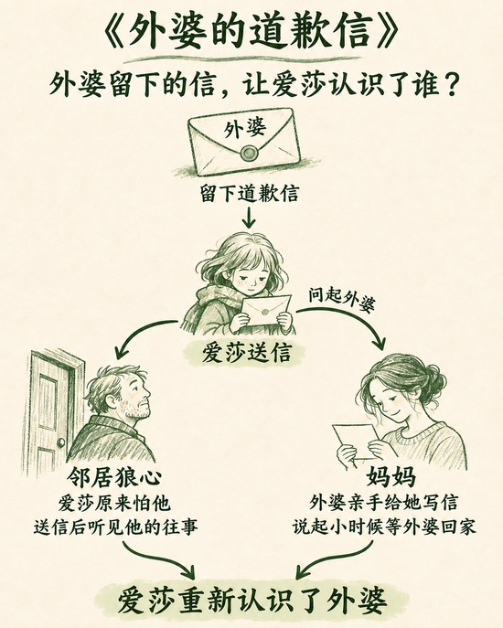

# wechat-reading-skills
把读书笔记变成一篇能在手机上读的公众号文章。源自 WMelon会客厅的编辑实践，这套开源 Skills 提供写作、审稿、排版三项能力，可在 Codex 中单独调用，也可串起来用。给原书摘录、笔记或可信资料，就能拟标题、找开场、写正文。已有稿件时，可逐段检查来源、案例、结论和图文关系，再生成微信兼容 HTML 与手机预览。仓库附两套真实演示。《全球通史》从一口辣椒写到跨洋贸易，《外婆的道歉信》用改图前后对照，展示怎样把人物关系接到故事转折上。首屏总图、正文配图、图注和文末书封卡都有示例，方便把同一套规则用到自己的下篇文章。适合做读书号、知识长文，或想统一团队审稿和排版方式的创作者。附安装说明、可运行样例和可替换主题，排版可在本地运行。

## 从两篇实际稿件看效果
### 《全球通史》｜从吃火锅写到世界史


> 吃火锅的时候，谁会特意想一想辣椒的来历？

开头借一件熟悉的事提出一个能追下去的问题。正文顺着辣椒的传播，讲航线、贸易和地方饮食怎样发生联系。案例页标出了怎么挑开场，以及哪些历史说法需要分别核对。

[看开篇和审稿说明](examples/global-history/README.md)
### 《外婆的道歉信》｜看懂一封信怎样把人物连起来


爱莎把信送给邻居，从他那里听到一段往事。妈妈也收到一封信，是外婆亲手写给她的。新版首图把这两条线画到一起，读者能顺着人物和行动理解爱莎为何重新认识外婆。

[看改图前后和手机开篇预览](examples/story-map/README.md)
## 按手头的材料选 Skill

| 你现在有 | 对应 Skill | 你会拿到 |
| --- | --- | --- |
| 原书摘录、资料或笔记 | [`wechat-reading-write`](skills/wechat-reading-write/SKILL.md) | 标题、开篇、正文、来源记录和配图简报 |
| 一篇待审的文章 | [`wechat-reading-review`](skills/wechat-reading-review/SKILL.md) | 标到具体段落的修订建议、事实核对和待核事项 |
| 一篇已定稿的 Markdown | [`wechat-reading-layout`](skills/wechat-reading-layout/SKILL.md) | 微信兼容 HTML、手机宽度预览和排版检查 |
## 用自己的材料试一遍
> 根据我提供的资料，给第一次读这本书的人写一篇公众号文章。选一个他们熟悉的场景开头，在正文里回答标题的问题。逐条核对书中观点、外部事实和你的解读，标出资料支持不了的说法，再输出排好的图文和手机预览。
## 在 Codex 里使用
把本仓库的三个 Skill 文件夹复制到项目的 `.agents/skills/`，也可以复制到用户目录的 `~/.agents/skills/` 以供各项目使用。打开对应项目后，在对话里用 `$wechat-reading-write`、`$wechat-reading-review` 或 `$wechat-reading-layout` 指定需要的能力。[Codex Skills 使用说明](https://learn.chatgpt.com/docs/build-skills)
## 跑一个本地排版样例
需要 Python 3.10 或更新版本。脚本使用 Python 标准库。
```text
python skills/wechat-reading-layout/scripts/render.py examples/story-map/article.json --output build/story-map
```
在 macOS 上，如果 Python 命令是 `python3`，把开头的 `python` 换成 `python3`。打开 `build/story-map/preview.html` 查看效果。输出同时包含微信正文片段 `article.html` 和本地图片目录 `assets/`。

- [《外婆的道歉信》排版样例](examples/story-map/article.json)
- [《全球通史》排版样例](examples/global-history/article.json)
- [换成自己的稿件与素材](skills/wechat-reading-layout/references/article-manifest.md)
## 许可
技能说明与代码采用 MIT。[许可证](LICENSE)  
案例文案与插图由 WMelon会客厅提供，作为展示素材。

