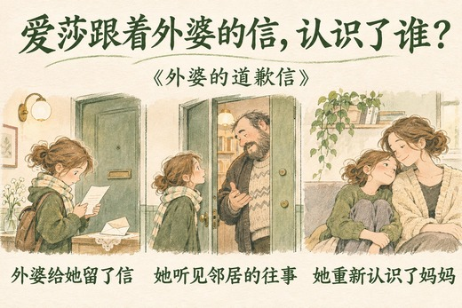
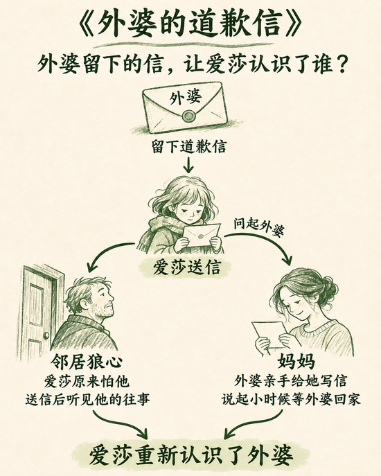
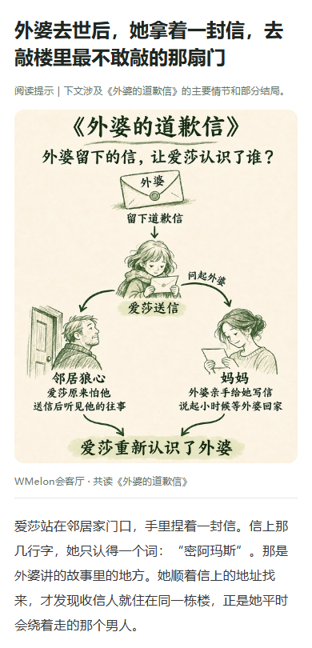

# 《外婆的道歉信》的首屏是怎样改的
文章从爱莎拿着信去敲门写起。读者接下来会碰到好几个人，需要知道每个人为什么和这封信有关。
以下预览涉及部分情节。
## 初版图

初版读得出三件事的顺序。妈妈那条线为什么会出现，以及她和邻居分别让爱莎知道了什么，还需要读正文才能补齐。
## 修订后的图

审稿时重新核对每条线。爱莎把信送给邻居，听到他的往事。妈妈的信是外婆亲手写给她的，图上用「问起外婆」连接爱莎和妈妈。两条线最后回到爱莎怎样重新理解外婆。
## 放到手机宽度下看开篇

这是从实际稿件摘取的本地浏览器预览。情节提示在图前，图下直接进入爱莎敲门的故事。
[手机预览 HTML](preview.html) 可下载后本地打开，保留旁边的 images 文件夹。
文案和插图选自 WMelon会客厅的公众号稿件。[原书出版方简介](https://www.simonandschuster.com/books/My-Grandmother-Asked-Me-to-Tell-You-Shes-Sorry/Fredrik-Backman/9781501115073)
